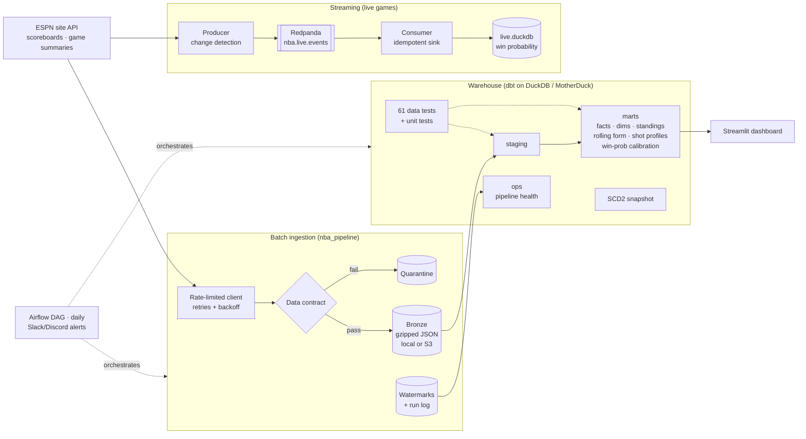

# NBA Data Platform

An end-to-end data platform for NBA games. It ingests every game of the season (box scores, play-by-play and win probability) from ESPN's public API and lands raw data in a bronze layer. dbt models that into a tested DuckDB/MotherDuck warehouse, Airflow runs it all daily with alerting, a Streamlit dashboard serves it, and a Redpanda pipeline streams live games.



## Highlights

**Ingestion**
- **Survived a source shutdown.** NBA.com's CDN began refusing all scripted traffic in 2026. The pipeline was migrated to ESPN with changes contained to the client, contracts and staging models; the write-up is in [docs/SOURCE_MIGRATION.md](docs/SOURCE_MIGRATION.md).
- **Incremental, idempotent loads.** The pipeline reads ESPN's season calendar and keeps a **date watermark**: the latest date on which every game is landed or postponed. Re-runs re-download nothing, and state is saved after every game, so a crash loses at most one game of work.
- **Failures are classified, never swallowed.** `401/403` means *blocked* (the run fails and alerts), `404` means *not available*, and `429/5xx` are retried with exponential backoff. The original silent "success, 0 games" failure can't recur.
- **Postponed games and stat corrections.** Postponed games don't block the watermark; in-progress games do. A daily refresh re-pulls the last 3 days and hashes only the game facts (never news or odds), so a real stat correction is re-landed and the incremental fact table replaces the stale rows.
- **Data contracts at the edge, tested on real payloads.** Contracts and parsers are tested against real ESPN responses captured as fixtures. Violations are quarantined with the reason instead of becoming silent NULLs.
- **Lineage.** Each bronze file records its source URL, run ID and ingestion time.

**Warehouse (dbt)**
- 18 models in three layers, staging → marts plus an **ops** layer for pipeline health, plus a seed that maps ESPN team codes to NBA tricodes. Includes an **incremental** fact table (`delete+insert`), an **SCD Type 2 snapshot**, a **gaps-and-islands** model that rebuilds every player's trade history from game rosters, rolling-window form metrics, and a **win-probability calibration** mart that scores ESPN's model against a naive baseline (Brier score, reliability by bucket).
- **61 data tests and 2 unit tests.** Includes invariants such as "a team's score equals the sum of its players' points" and "every game has exactly one winner". Unit tests pin the true shooting %, eFG % and Game Score formulas, and the trade-detection logic.

**Operations**
- The Airflow 3.3 DAG runs daily (scoreboard ∥ backfill → refresh → `dbt build` → freshness check → report), with retries and exponential backoff, plus failure alerts to Slack or Discord.
- The run log feeds `ops.mart_pipeline_health`: success rate, request volume, latency, corrections and quarantines per day, shown on the dashboard.

**Serving and streaming**
- The **Streamlit dashboard** has five tabs: standings, leaderboards, a player explorer (rolling form, shot profile, shot chart, team history), win-probability calibration, and pipeline health.
- The **live pipeline** polls ESPN's scoreboard (one request covers every game), turns snapshot diffs into events (`score_change`, `lead_change`, `game_final`, …), publishes them to Redpanda keyed by game, and consumes them into DuckDB. Delivery is at-least-once, with deterministic event IDs as primary keys, so replays are ignored and results come out as if exactly once. A view computes a baseline live win probability.

**CI**
- GitHub Actions seeds synthetic data that mirrors ESPN's real structure (the tests prove it matches the captured fixtures). It then runs lint, about 60 unit tests (including the streaming sink against a real DuckDB) and `dbt build` twice (the second run proves the incremental model is idempotent), renders the dashboard against the built warehouse, and parses the Airflow DAG.

## Stack

| Layer | Tools |
|---|---|
| Source | ESPN public site API (scoreboard + game summary) |
| Ingestion | Python, `requests`, pytest |
| Storage | Gzipped JSON on local disk or S3 |
| Warehouse | DuckDB locally, MotherDuck in the cloud |
| Transformation | dbt-core + dbt-duckdb (incremental models, snapshots, unit tests) |
| Orchestration | Apache Airflow 3.3 (TaskFlow API), Docker Compose |
| Streaming | Redpanda (Kafka API), kafka-python |
| Serving | Streamlit + Altair |
| CI | GitHub Actions, ruff |

## Data model

| Model | Grain | What it's for |
|---|---|---|
| `stg_nba__summary_payloads` | game | The only model that reads raw JSON |
| `stg_nba__games` / `__team_games` / `__player_games` / `__pbp_actions` / `__win_probability` | game / team-game / player-game / play / play | Typed, flattened data; stats looked up by key name, not position |
| `dim_teams`, `dim_players` | team / player | Current attributes |
| `snap_players` *(snapshot)* | player version | SCD2 history of team, position and name |
| `fct_player_games` *(incremental)* | player × game | True shooting %, eFG %, Game Score, double-doubles |
| `fct_team_games` | team × game | Result, margin, overtime |
| `fct_player_team_stints` | player × stint | Trade and signing history (gaps-and-islands) |
| `mart_team_standings` | season × team | Record, home/away, last 10, streak, rank |
| `mart_player_season_averages` | season × player | Per-game averages, shooting % from totals |
| `mart_player_rolling_form` | player × game | 5/10-game rolling stats, form vs. season |
| `mart_player_shot_profile` | season × player × zone | Shot distribution and FG% by distance |
| `mart_win_probability_calibration` | model × probability bucket | ESPN vs. baseline calibration and Brier score |
| `ops.mart_pipeline_health` | day × job | Pipeline success rate, volume, latency |

## Quickstart

```bash
python -m venv .venv && source .venv/bin/activate
make setup && make test

# No network needed: sample data
make sample && make dbt-build && make dashboard        # http://localhost:8501

# Real data
nba-pipeline backfill --season 2026 --max-games 20     # try a few games first
make backfill && make dbt-build && make dashboard

# Daily orchestration
make airflow-up                                        # http://localhost:8080

# Live games (during game time)
make stream-broker
make stream-consume    # terminal 1
make stream-produce    # terminal 2
duckdb warehouse/live.duckdb "select * from live.latest_game_state"
```

Moving to the cloud (MotherDuck, S3, a hosted dashboard) is covered in **[docs/CLOUD.md](docs/CLOUD.md)**, along with what would change at larger scale.

## Project layout

```
src/nba_pipeline/     ingestion, contracts, state, alerts, live change-detection, CLI
tests/                unit tests (mocked HTTP, streaming sink) + real ESPN fixtures
transform/            dbt: staging, marts, ops, snapshots, unit + data tests
orchestration/dags/   Airflow DAG
streaming/            Redpanda producer and DuckDB consumer
dashboard/            Streamlit app
docker/, scripts/     Airflow image, S3 sync
docs/                 roadmap, cloud guide, source-migration write-up
```

## Data source note

Data comes from ESPN's public site API (`site.api.espn.com/apis/site/v2/sports/basketball/nba`). It's unofficial and undocumented, which is why the data contracts, quarantine and real-payload fixtures exist. This is a non-commercial portfolio project: the client sends at most 2 requests per second, identifies itself in its User-Agent, and never re-downloads a game it already has.
